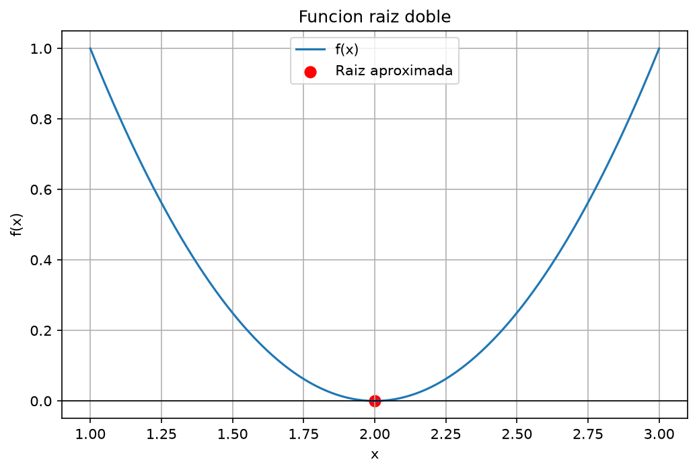
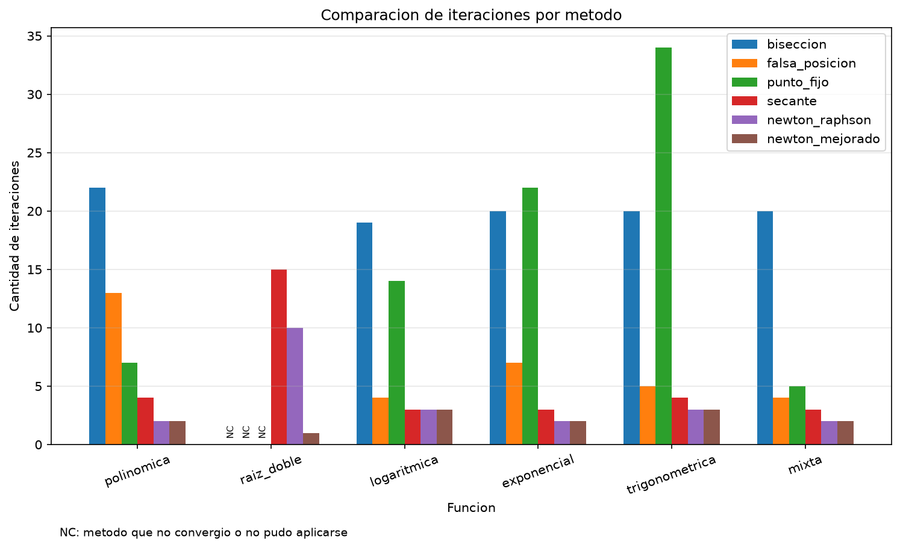
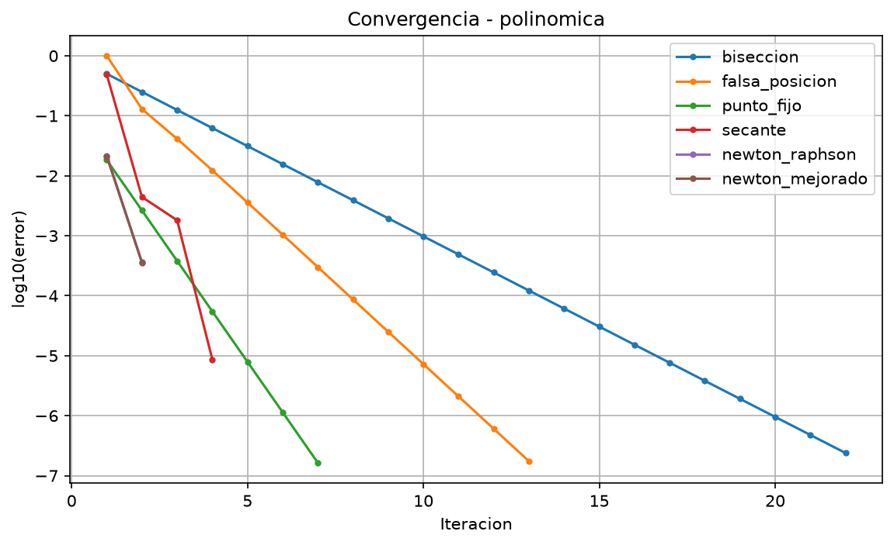
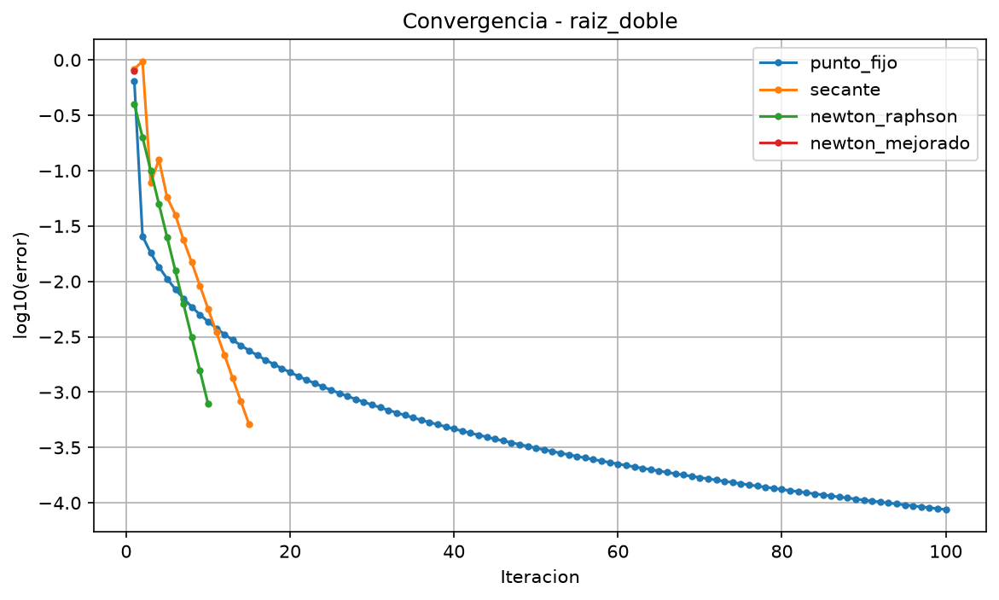

# Informe de convergencia - Evaluación 2: Búsqueda de raíces

## 1. Objetivo y ambiente de pruebas

El objetivo de este laboratorio fue implementar y comparar seis métodos numéricos para encontrar raíces de ecuaciones de la forma $f(x)=0$:

- Bisección.
- Falsa posición.
- Punto fijo.
- Secante.
- Newton-Raphson.
- Newton-Raphson mejorado.

Para hacer la comparación utilizamos seis funciones de distintos tipos, incluyendo una función con raíz doble. Analizamos las raíces aproximadas, el número de iteraciones, el comportamiento de los errores y los casos donde un método no pudo aplicarse o no alcanzó la tolerancia.

Las condiciones generales fueron las siguientes:

- **Tolerancia:** `1e-6`.
- **Máximo de iteraciones:** `100`.
- **Intervalos:** los indicados para cada función.
- **Aproximaciones iniciales:** las definidas para los métodos abiertos.

Cada ejecución registra la raíz aproximada, el número de iteraciones, un error estimado, el estado de convergencia y el historial de aproximaciones. En los programas, el criterio de parada utilizado principalmente es que el residuo $|f(x)|$ sea menor que la tolerancia. Para punto fijo se exige, además, que el cambio entre aproximaciones sea menor que la tolerancia.

Es importante distinguir el **residuo**, el **cambio entre aproximaciones** y el **error verdadero respecto de una raíz conocida**, ya que no son necesariamente iguales. En los gráficos de convergencia se representa el error registrado en el historial, generalmente asociado al cambio entre aproximaciones. En la primera iteración de algunos métodos cerrados se usa una estimación basada en el intervalo.

## 2. Funciones utilizadas

Las funciones utilizadas durante el laboratorio fueron las siguientes:

| Función | Expresión | Intervalo | Valores iniciales |
|---|---|---|---|
| Polinómica | $x^3-x-2$ | `[1, 2]` | `p0 = 1.5`, `p1 = 2.0` |
| Raíz doble | $(x-2)^2$ | `[1, 3]` | `p0 = 1.2`, `p1 = 2.5` |
| Logarítmica | $\ln(x)+x-4$ | `[2, 3]` | `p0 = 2.5`, `p1 = 3.0` |
| Exponencial | $e^{-x}-x$ | `[0, 1]` | `p0 = 0.5`, `p1 = 1.0` |
| Trigonométrica | $\cos(x)-x$ | `[0, 1]` | `p0 = 0.5`, `p1 = 1.0` |
| Mixta | $\sqrt{x}-\cos(x)$ | `[0.1, 1]` | `p0 = 0.5`, `p1 = 1.0` |

Las funciones, sus derivadas y las transformaciones $g(x)$ para punto fijo están definidas en `src/scripts/funciones_prueba.py`.

## 3. Comprobación de las raíces en los intervalos

Para aplicar bisección y falsa posición mediante el criterio habitual de cambio de signo, comprobamos los valores de la función en los extremos de cada intervalo.

| Función | f(a) | f(b) | Cambio de signo |
|---|---:|---:|---|
| Polinómica | -2.000000 | 4.000000 | Sí |
| Logarítmica | -1.306853 | 0.098612 | Sí |
| Exponencial | 1.000000 | -0.632121 | Sí |
| Trigonométrica | 1.000000 | -0.459698 | Sí |
| Mixta | -0.678776 | 0.459698 | Sí |

En estos cinco casos se cumple $f(a)f(b)<0$. Como las funciones son continuas en sus intervalos, el teorema del valor intermedio garantiza que existe al menos una raíz en cada uno.

La función con raíz doble es diferente:

$$
f(x)=(x-2)^2, \qquad f(1)=1, \qquad f(2)=0, \qquad f(3)=1.
$$

Su raíz es $x=2$ y, además, $f'(2)=0$ y $f''(2)=2>0$. La curva toca el eje horizontal, pero no lo cruza. Por eso no existe cambio de signo entre `1` y `3`, y bisección y falsa posición no pueden aplicarse con la comprobación de signos utilizada en nuestros programas.

**Figura 1.** La función $f(x)=(x-2)^2$ presenta una tangencia con el eje horizontal en $x=2$, sin cambio de signo alrededor de la raíz.

## 4. Resultados generales

El archivo `src/data/resumen_metodos.csv` reúne **36 ejecuciones**, correspondientes a seis métodos aplicados a seis funciones. De ellas, **33 cumplieron el criterio de convergencia del programa** y **3 no convergieron o no pudieron aplicarse**.

La cantidad de iteraciones fue la siguiente:

| Función | Bisección | Falsa posición | Punto fijo | Secante | Newton | Newton mejorado |
|---|---:|---:|---:|---:|---:|---:|
| Polinómica | 22 | 13 | 7 | 4 | 2 | 2 |
| Raíz doble | NC | NC | NC (100) | 15 | 10 | 1 |
| Logarítmica | 19 | 4 | 14 | 3 | 3 | 3 |
| Exponencial | 20 | 7 | 22 | 3 | 2 | 2 |
| Trigonométrica | 20 | 5 | 34 | 4 | 3 | 3 |
| Mixta | 20 | 4 | 5 | 3 | 2 | 2 |

**NC** significa que el método no convergió dentro del límite establecido o que no pudo aplicarse con las condiciones seleccionadas. En particular, punto fijo realizó 100 iteraciones en la raíz doble sin cumplir el criterio de parada.

Algunas raíces aproximadas obtenidas con Newton-Raphson mejorado fueron:

| Función | Raíz aproximada |
|---|---:|
| Polinómica | 1.521380 |
| Raíz doble | 2.000000 |
| Logarítmica | 2.926271 |
| Exponencial | 0.567143 |
| Trigonométrica | 0.739085 |
| Mixta | 0.641714 |

*Figura 2. Comparación de iteraciones entre los métodos. Los casos marcados como NC no deben interpretarse como convergencia en cero iteraciones. Esta figura permite comparar los métodos que cumplieron el criterio, pero no representa mediante una barra las 100 iteraciones consumidas por punto fijo en la raíz doble.*

## 5. Análisis de convergencia

### 5.1. ¿Qué método convergió en menos iteraciones para cada función? ¿Por qué?

Los resultados de la tabla y de la figura 2 muestran lo siguiente:

- **Polinómica:** Newton-Raphson y Newton mejorado necesitaron 2 iteraciones.
- **Raíz doble:** Newton mejorado fue el más rápido, con 1 iteración.
- **Logarítmica:** secante, Newton-Raphson y Newton mejorado necesitaron 3 iteraciones.
- **Exponencial:** Newton-Raphson y Newton mejorado necesitaron 2 iteraciones.
- **Trigonométrica:** Newton-Raphson y Newton mejorado necesitaron 3 iteraciones.
- **Mixta:** Newton-Raphson y Newton mejorado necesitaron 2 iteraciones.

En las raíces simples, Newton-Raphson fue uno de los métodos más rápidos porque aprovecha la información de la derivada para corregir cada aproximación. Secante también obtuvo buenos resultados sin calcular derivadas de forma explícita.

Bisección necesitó más iteraciones que Newton-Raphson y secante en las cinco funciones con raíces simples, aunque mostró un comportamiento estable cuando el intervalo tenía cambio de signo. Sin embargo, **no fue más lento que todos los métodos abiertos**: en la exponencial utilizó 20 iteraciones frente a las 22 de punto fijo, y en la trigonométrica 20 frente a 34 de punto fijo.

Por tanto, el número de iteraciones depende tanto del método como de la función y sus condiciones iniciales. Menos iteraciones tampoco significa necesariamente un menor tiempo de ejecución, porque los métodos tienen diferentes costos por iteración.

### 5.2. ¿Qué orden de convergencia tiene cada método y cómo se observa en los gráficos?

El **orden de convergencia** describe la rapidez con la que disminuye el error cuando las aproximaciones ya están suficientemente cerca de la raíz. El comportamiento teórico no tiene por qué observarse claramente en todas nuestras corridas, especialmente cuando un método termina en solo dos o tres iteraciones.

- **Bisección:** tiene convergencia lineal. En cada iteración el ancho del intervalo se reduce a la mitad. En una representación logarítmica del tamaño del intervalo se espera una disminución aproximadamente regular.
- **Falsa posición:** suele tener convergencia lineal para raíces simples bajo condiciones habituales. Según la forma de la función, uno de los extremos puede cambiar muy poco y disminuir su velocidad.
- **Punto fijo:** su comportamiento depende de la transformación $g(x)$. Cuando $0<|g'(\alpha)|<1$, la convergencia local suele ser lineal. Si $|g'(\alpha)|$ no es menor que 1, esa condición suficiente deja de aplicarse; el método puede converger lentamente, divergir o necesitar otro análisis.
- **Secante:** para raíces simples y condiciones apropiadas presenta orden superlineal aproximado $p=(1+\sqrt{5})/2\approx1.618$. En la raíz doble de este laboratorio, su convergencia es lineal, no de orden 1.618.
- **Newton-Raphson:** cerca de una raíz simple, con derivada no nula y condiciones regulares, presenta convergencia cuadrática (orden 2). Para la raíz doble $(x-2)^2$, el Newton ordinario pasa a ser lineal.
- **Newton-Raphson mejorado:** la fórmula con primera y segunda derivada utilizada en el proyecto tiene convergencia cuadrática local bajo condiciones regulares, incluso para raíces múltiples, sin necesidad de conocer previamente su multiplicidad. En nuestro polinomio con raíz doble llega exactamente a $x=2$ en un paso, un caso particular que no permite medir un orden experimental a partir de varias iteraciones.

Los gráficos del proyecto representan `log10(error)` frente a la iteración. **Ese error corresponde al valor registrado en el historial, generalmente al cambio absoluto entre dos aproximaciones**, y no necesariamente al error verdadero $|x_n-\alpha|$. En las primeras iteraciones de bisección y falsa posición se utiliza una estimación asociada al intervalo inicial.

*Figura 3. Evolución del error registrado por iteración para la función polinómica. Los métodos de Newton y secante reducen rápidamente ese valor y terminan en pocas iteraciones; bisección muestra una disminución más gradual. Dado que algunos métodos terminan en dos iteraciones, el gráfico ilustra su rapidez en esta prueba, pero no permite estimar por sí solo un orden asintótico exacto.*

En general, una caída más pronunciada de las curvas indica que el cambio entre aproximaciones disminuyó más rápidamente. Esto ayuda a explicar las diferencias de iteraciones, pero se debe mirar también el residuo y el estado de convergencia antes de concluir que una aproximación es precisa.

### 5.3. ¿Qué métodos necesitan un intervalo con cambio de signo y cuáles no?

En las implementaciones utilizadas, los métodos que requieren un intervalo con cambio de signo son **bisección** y **falsa posición**. Para las raíces simples estudiadas verificamos que $f(a)f(b)<0$.

Los métodos **punto fijo, secante, Newton-Raphson y Newton-Raphson mejorado** no requieren ese intervalo. En cambio, dependen de la transformación elegida, los valores iniciales y las propiedades de la función y sus derivadas.

Por esta razón, los métodos abiertos pueden ser rápidos, pero también pueden alejarse de la raíz o detenerse cuando aparecen problemas como derivadas nulas o divisiones no definidas. Los métodos cerrados tienen la ventaja de mantener un intervalo con raíz cuando se cumplen sus condiciones de aplicación.

### 5.4. ¿Qué ocurrió con la raíz doble? ¿Qué métodos fallaron y cuál funcionó mejor?

La función considerada fue $f(x)=(x-2)^2$, cuya raíz exacta es $x=2$.

Bisección y falsa posición no se pudieron aplicar con el intervalo `[1, 3]` porque sus extremos tienen el mismo signo. Punto fijo no alcanzó la tolerancia durante las 100 iteraciones disponibles.

Los métodos restantes produjeron estos resultados:

| Método | Iteraciones | Raíz obtenida | Error respecto de $x=2$ |
|---|---:|---:|---:|
| Secante | 15 | 2.000825423 | 0.000825423 |
| Newton-Raphson | 10 | 1.999218750 | 0.000781250 |
| Newton mejorado | 1 | 2.000000000 | 0.000000000 |

**Newton-Raphson ordinario.** Si llamamos $e_n=x_n-2$ al error respecto de la raíz, entonces $f(x_n)=e_n^2$ y $f'(x_n)=2e_n$. Para $e_n\ne0$, la actualización de Newton da:

$$
x_{n+1}=x_n-\frac{e_n^2}{2e_n}=x_n-\frac{e_n}{2},
\qquad e_{n+1}=\frac{e_n}{2}.
$$

Esto demuestra que, en esta raíz doble, **Newton ordinario converge linealmente**: el error verdadero se reduce a la mitad por iteración, en lugar de disminuir cuadráticamente como ocurre cerca de una raíz simple.

**Secante.** También converge linealmente en este caso de raíz múltiple, aunque para raíces simples suele tener orden cercano a 1.618. En nuestros resultados necesitó 15 iteraciones para satisfacer el criterio de residuo.

**Punto fijo.** La transformación utilizada fue $g(x)=x+(x-2)^2$. Para la raíz $\alpha=2$ se cumple $g'(2)=1$, por lo que no se obtiene una contracción estricta en la raíz. Si escribimos $e_n=x_n-2$, se tiene:

$$
e_{n+1}=e_n+e_n^2=e_n(1+e_n).
$$

Como el valor inicial es `p0 = 1.2`, el error comienza siendo negativo. Las aproximaciones se acercan a 2 desde la izquierda, pero la razón $|e_{n+1}|/|e_n|$ se acerca a 1. Se trata de una **convergencia sublineal muy lenta**. Por eso es más preciso decir que punto fijo *no alcanzó la tolerancia en 100 iteraciones*, y no que nunca podría converger.

**Newton-Raphson mejorado.** La fórmula implementada es:

$$
x_{n+1}=x_n-\frac{f(x_n)f'(x_n)}{[f'(x_n)]^2-f(x_n)f''(x_n)}.
$$

Para $f(x)=e^2$, $f'(x)=2e$ y $f''(x)=2$, se obtiene, siempre que el punto inicial no sea ya la raíz:

$$
x_{n+1}=x_n-\frac{e^2(2e)}{(2e)^2-e^2(2)}
=x_n-e=2.
$$

Esto explica por qué el método mejorado encontró la raíz exacta en **una sola iteración** desde `p0 = 1.2`.

*Figura 4. Evolución del error registrado para la raíz doble. Punto fijo muestra una reducción muy lenta, pero la ejecución terminó sin cumplir el criterio de convergencia después de 100 iteraciones (NC). Newton ordinario se comporta linealmente. El único punto de Newton mejorado corresponde al salto de 0.8 desde 1.2 hasta 2, por lo que aparece como `log10(0.8)`: **no significa que la raíz final tenga ese error**; la raíz obtenida fue exactamente 2.*

Finalmente, es importante interpretar correctamente la tolerancia. Para esta función:

$$
|f(x)|=|x-2|^2<10^{-6}
\quad\Longrightarrow\quad |x-2|<10^{-3}.
$$

Por eso secante y Newton ordinario fueron registrados como convergentes mediante el criterio de residuo, aunque sus errores verdaderos de raíz eran aproximadamente `0.0008`. El enunciado permite detener por residuo, de manera que esos registros son válidos según el criterio utilizado, pero **no deben describirse como aproximaciones con error verdadero menor que `1e-6`**.

### 5.5. ¿Cómo influyen el intervalo y los valores iniciales?

Para analizar esta pregunta se realizaron **nueve pruebas adicionales** con la función polinómica $f(x)=x^3-x-2$. Se mantuvieron la tolerancia `1e-6` y el máximo de 100 iteraciones. Solo cambiaron los intervalos o las aproximaciones iniciales.

Los resultados se encuentran en `src/data/comparacion_condiciones.csv`:

| Método | Condiciones | Iteraciones | Raíz | Residuo |
|---|---|---:|---:|---:|
| Bisección | `[1, 2]` | 22 | 1.521379709 | 1.4498e-08 |
| Bisección | `[1.4, 1.6]` | 18 | 1.521379852 | 8.6476e-07 |
| Bisección | `[1.5, 1.55]` | 16 | 1.521379852 | 8.6476e-07 |
| Newton-Raphson | `p0 = 1` | 5 | 1.521379710 | 1.7407e-08 |
| Newton-Raphson | `p0 = 1.5` | 2 | 1.521379806 | 5.8939e-07 |
| Newton-Raphson | `p0 = 2` | 4 | 1.521379710 | 1.7407e-08 |
| Secante | `p0 = 1, p1 = 2` | 6 | 1.521379708 | 7.0155e-09 |
| Secante | `p0 = 1.4, p1 = 1.6` | 4 | 1.521379706 | 4.9929e-09 |
| Secante | `p0 = 1.5, p1 = 1.6` | 3 | 1.521379776 | 4.1377e-07 |

Los nueve casos alcanzaron un residuo menor que `1e-6`.

**Bisección.** Al reducir el intervalo inicial de `[1, 2]` a `[1.4, 1.6]` y luego a `[1.5, 1.55]`, la cantidad de iteraciones disminuyó de **22 a 18 y a 16**, respectivamente. En estas pruebas, partir de un intervalo menor redujo la cantidad de subdivisiones necesarias.

**Newton-Raphson.** Desde `p0 = 1` necesitó 5 iteraciones; desde `p0 = 1.5`, solo 2; y desde `p0 = 2`, 4. Entre los tres valores evaluados, `1.5` fue el más favorable.

**Secante.** Con los puntos `(1, 2)` necesitó 6 iteraciones; con `(1.4, 1.6)`, 4; y con `(1.5, 1.6)`, 3. La selección de dos aproximaciones cercanas a la raíz favoreció la rapidez en los casos ensayados.

Estos resultados muestran que las condiciones iniciales pueden influir bastante en la cantidad de iteraciones, pero **no prueban que una aproximación más cercana sea siempre mejor para cualquier función**. Los nueve casos adicionales convergieron, por lo que este experimento compara principalmente la rapidez y no demuestra experimentalmente qué condiciones provocan un fracaso.

También se observa que menos iteraciones no equivale siempre a un residuo final menor. Por ejemplo, Newton desde `p0 = 1.5` utilizó 2 iteraciones y terminó con un residuo cercano a `5.89e-07`, mientras que desde `p0 = 1` utilizó 5 iteraciones y terminó cerca de `1.74e-08`.

### 5.6. ¿Qué método recomendamos según la función, la velocidad y la robustez?

Cuando se dispone de la derivada y de una aproximación inicial adecuada, **Newton-Raphson** es una buena alternativa por su rapidez. En nuestras pruebas necesitó 2 iteraciones para las funciones polinómica, exponencial y mixta, y 3 para la trigonométrica y la logarítmica.

Si no se desea calcular derivadas, **secante** es una opción útil. Para las raíces simples del laboratorio terminó en 3 o 4 iteraciones según la función, aunque depende de los dos puntos de partida.

Cuando se conoce un intervalo con cambio de signo y se busca un procedimiento sencillo y confiable, **bisección** es una buena elección, aunque normalmente requirió más iteraciones que Newton y secante. **Falsa posición** fue más rápida que bisección en nuestras cinco raíces simples; por ejemplo, en la función logarítmica necesitó 4 iteraciones frente a 19 de bisección.

Para la función con raíz doble, **Newton-Raphson mejorado** obtuvo el mejor resultado al encontrar exactamente $x=2$ en un paso. Este comportamiento es especialmente favorable en el ejemplo elegido, pero no implica que siempre termine en una iteración para cualquier función.

**Punto fijo** puede ser eficaz si se escoge una transformación adecuada. En la función mixta convergió en 5 iteraciones, mientras que en la raíz doble, con la transformación utilizada, no alcanzó el criterio de parada en 100 iteraciones.

Por lo tanto, nuestra recomendación depende de las propiedades de la función, las derivadas disponibles, la existencia de cambio de signo, los valores iniciales y la precisión que se necesite.

## 6. Conclusión

Los resultados del laboratorio muestran que **no existe un método que sea siempre el mejor para todos los problemas**.

En las cinco funciones con raíces simples, Newton-Raphson y Newton-Raphson mejorado estuvieron entre los métodos con menos iteraciones. Secante también tuvo buenos resultados y no necesita calcular derivadas. Bisección necesitó generalmente más iteraciones que estos métodos, pero mantuvo el intervalo con raíz cuando se cumplían sus condiciones de aplicación.

La raíz doble permitió observar diferencias importantes. Como $f(x)=(x-2)^2$ no cambia de signo alrededor de $x=2$, bisección y falsa posición no fueron aplicables con el intervalo seleccionado. Punto fijo se acercó lentamente a la raíz, pero no cumplió la tolerancia en 100 iteraciones. Newton ordinario y secante convergieron más lentamente que en raíces simples, mientras que Newton mejorado encontró exactamente la raíz en un paso.

Este caso también mostró por qué es necesario **distinguir entre residuo y error verdadero**: que $|f(x)|<10^{-6}$ no garantiza por sí solo que una raíz doble esté aproximada con error menor que `1e-6`.

En las nueve pruebas adicionales se observó el efecto de las condiciones iniciales. Para la función polinómica, bisección pasó de 22 a 16 iteraciones al reducir el intervalo; Newton-Raphson utilizó entre 2 y 5; y secante, entre 3 y 6. Todas esas ejecuciones convergieron, de modo que los resultados muestran diferencias de rapidez sin demostrar que cualquier condición inicial conduzca al éxito.

Para elegir un método conviene considerar el tipo de función, la disponibilidad de derivadas, la existencia de un intervalo con cambio de signo, las aproximaciones iniciales, la posible multiplicidad de la raíz y la precisión requerida. Los métodos abiertos pueden ser muy rápidos cuando parten de buenas condiciones; los cerrados proporcionan mayor seguridad cuando existe un intervalo válido con cambio de signo.

## 7. Archivos relacionados

Los archivos utilizados para realizar este análisis son:

- `src/data/resumen_metodos.csv`: resultados de las 36 combinaciones principales.
- `src/data/comparacion_condiciones.csv`: nueve pruebas con distintos intervalos o puntos iniciales.
- `src/data/`: muestras de las seis funciones.
- `src/assets/`: gráficos de funciones, convergencia y comparación de iteraciones.
- `src/scripts/`: implementaciones de los métodos y programas que generan los resultados.

Los valores y las figuras presentados corresponden a los experimentos realizados durante el laboratorio.
